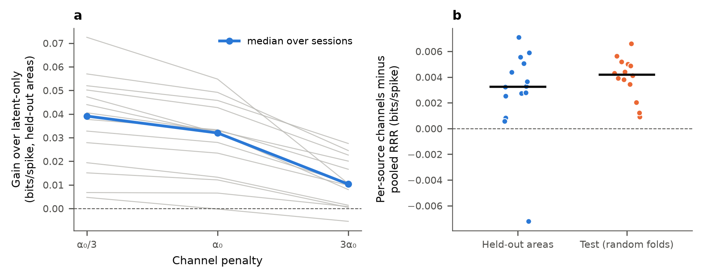
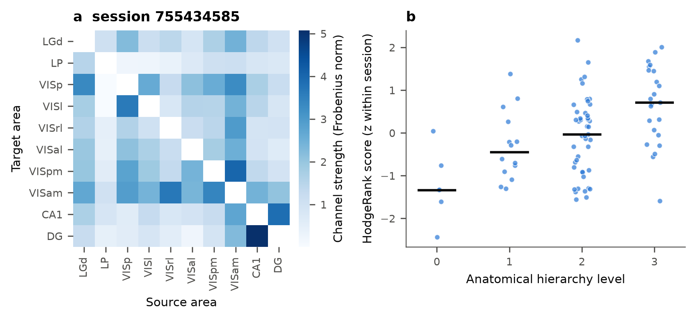

# Membrane SNP

Supporting figures, summary data, and per-session result tables for **Membrane SNP** — a spiking neural P system with low-rank delayed membrane channels and a slow autoregressive hidden input for identifying inter-area communication in multi-area spike trains.

---

## Key Empirical Results (14 Allen Neuropixels Sessions)

- **Held-out area prediction (H10):** Membrane channels improve prediction of entirely held-out brain areas by a median of **0.0320 bits/spike** over a hidden-input-only model (13/14 sessions, Wilcoxon `p = 1.2e-4`), holding across a ninefold range of channel penalties (`α₀/3` to `3α₀`).
- **Per-source channels vs. pooled subspace (F5):** Separate per-source channels outperform a pooled reduced-rank regression map of equal rank on held-out areas in 13/14 sessions (median `0.0033 bits/spike`, `p = 0.0067`) and on randomly held-out neurons in 14/14 sessions (median `0.0042 bits/spike`, `p = 6.1e-5`).
- **Low-data efficiency & channel rank (F1, H1/F2):** Membrane structure improves prediction over an unstructured cross-area model by a median of **0.0508 bits/spike** at 10% of training data (14/14 sessions, `p = 6.1e-5`); 90% of channel gain is reached at rank 6 (interpolated median `r₉₀ = 4.83`).
- **Visual hierarchy & convergence (H4, H5, H6):** Fitted channels recover the anatomical visual hierarchy (median Spearman `ρ = 0.61`, `p < 0.001`), stay consistent at 50% data (median Kendall `τ = 0.77`), and converge at median log–log slope `-0.45` (vs. theoretical `-1/2`).
- **Dale's law / anti-spikes (H12, H16):** Constraining neurons to emit only excitatory spikes or inhibitory anti-spikes costs a median **1.71%** of held-out likelihood while enriching inhibitory assignments for narrow-spiking waveforms (odds ratio `1.86`).

---

## Figures





| Figure | Preview (PNG) | Vector (PDF) | Description |
| :--- | :--- | :--- | :--- |
| Delay basis | [`fig_basis.png`](figures/fig_basis.png) | [`fig_basis.pdf`](figures/fig_basis.pdf) | Raised-cosine delay basis functions (`5–50 ms`, lag >= 1 bin) |
| Loss curvature | [`fig_curvature.png`](figures/fig_curvature.png) | [`fig_curvature.pdf`](figures/fig_curvature.pdf) | Expected curvature of the softplus Poisson loss |
| Simulation trap | [`fig_sim_trap.png`](figures/fig_sim_trap.png) | [`fig_sim_trap.pdf`](figures/fig_sim_trap.pdf) | Separation trap in a simulated network with known channels |
| Session coverage | [`fig_coverage.png`](figures/fig_coverage.png) | [`fig_coverage.pdf`](figures/fig_coverage.pdf) | Recorded areas and unit counts across the 14 sessions |
| Held-out areas & RRR | [`fig2_heldout_areas_and_rrr.png`](figures/fig2_heldout_areas_and_rrr.png) | [`fig2_heldout_areas_and_rrr.pdf`](figures/fig2_heldout_areas_and_rrr.pdf) | Held-out area gain across penalties and vs. pooled RRR |
| Per-session breakdown | [`fig_sessions.png`](figures/fig_sessions.png) | [`fig_sessions.pdf`](figures/fig_sessions.pdf) | Per-session comparison across models |
| Random vs. area hold-out | [`fig_test_vs_heldout.png`](figures/fig_test_vs_heldout.png) | [`fig_test_vs_heldout.pdf`](figures/fig_test_vs_heldout.pdf) | Random neuron hold-out vs. whole-area hold-out |
| Data efficiency | [`fig3_data_efficiency.png`](figures/fig3_data_efficiency.png) | [`fig3_data_efficiency.pdf`](figures/fig3_data_efficiency.pdf) | Membrane SNP vs. flat model across training data fractions |
| Rank scan | [`fig4_rank.png`](figures/fig4_rank.png) | [`fig4_rank.pdf`](figures/fig4_rank.pdf) | Normalized channel gain as a function of rank |
| Hierarchy recovery | [`fig5_hierarchy.png`](figures/fig5_hierarchy.png) | [`fig5_hierarchy.pdf`](figures/fig5_hierarchy.pdf) | Channel strengths and HodgeRank scores vs. anatomical hierarchy |
| Net channel flow map | [`fig_channel_map.png`](figures/fig_channel_map.png) | [`fig_channel_map.pdf`](figures/fig_channel_map.pdf) | Net directed channel flow across areas (session 755434585) |
| Split-half convergence | [`fig6_split_half.png`](figures/fig6_split_half.png) | [`fig6_split_half.pdf`](figures/fig6_split_half.pdf) | Relative split-half channel difference vs. training length |
| Dale's law | [`fig7_dale.png`](figures/fig7_dale.png) | [`fig7_dale.pdf`](figures/fig7_dale.pdf) | Likelihood cost of sign constraints and waveform enrichment |
| Follow-up analyses | [`fig_followups.png`](figures/fig_followups.png) | [`fig_followups.pdf`](figures/fig_followups.pdf) | Per-session distributions for follow-up analyses F1–F5 |

---

## Tables & Summary Data

### Per-Session Result Tables (`supp_tables/`)

| File | Contents |
| :--- | :--- |
| [`supp_tables/t_sessions.tex`](supp_tables/t_sessions.tex) | Session IDs, neuron counts, membrane counts, area lists, and training bin counts |
| [`supp_tables/t_h10.tex`](supp_tables/t_h10.tex) | Held-out area gain across penalties (`α₀/3`, `α₀`, `3α₀`) and per-source vs. pooled RRR (H10, F5) |
| [`supp_tables/t_eff.tex`](supp_tables/t_eff.tex) | Membrane SNP minus flat model at 10%, 25%, 50%, and 100% training data (H2, F1) |
| [`supp_tables/t_rank.tex`](supp_tables/t_rank.tex) | Normalized channel gain at ranks 1–12, F2, interpolated `r₉₀`, and area-normalized rank (H1, F2) |
| [`supp_tables/t_struct.tex`](supp_tables/t_struct.tex) | Channel strength drop with hidden input (H8/F3), within-region vs. cross-system contrast (F4), Dale's law cost (H12), and split-half slope (H4) |
| [`supp_tables/t_scores.tex`](supp_tables/t_scores.tex) | Random held-out neuron test scores (bits/spike) across all five models |

### Machine-Readable Summaries (`figures/`)

- [`figures/numbers.json`](figures/numbers.json) — Numerical arrays and per-session values backing the main and supplementary figures.
- [`figures/followup.json`](figures/followup.json) — Summary statistics and per-session values for follow-up analyses F1–F5.

---

## Repository Layout

```text
.
├── README.md
├── figures/          # Vector PDFs, PNG previews, and JSON data summaries
└── supp_tables/      # Per-session LaTeX table fragments
```
